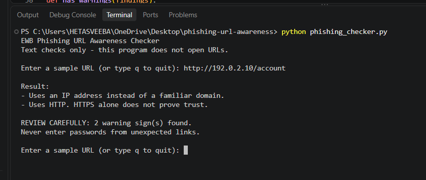
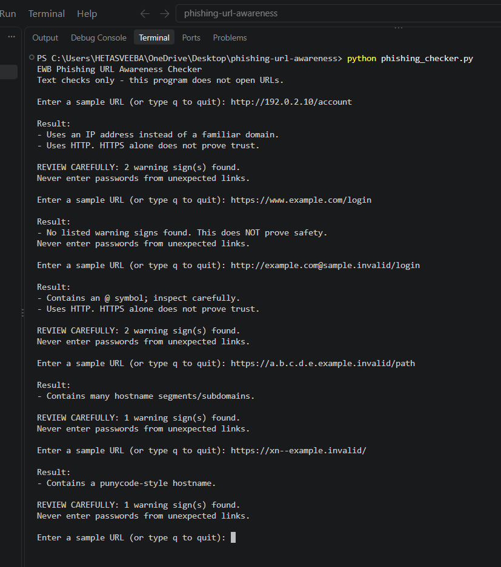

# EWB Phishing URL Awareness Checker

## Overview
Phishing is when someone sends a fake link to trick people into giving away passwords, card numbers or OTPs. This project is a small Python tool that reads the text of a URL and points out a few warning signs. It never opens the link or sends anything over the internet, so it is safe to test.

## Features
- Detects an @ symbol in the URL
- Flags unusually long URLs (over 100 characters)
- Flags IP-address hostnames
- Flags many hostname segments (5 or more)
- Flags punycode-style hostnames (xn--)
- Flags the HTTP scheme
- Loop mode: check many URLs without restarting, and type q to quit
- A "REVIEW CAREFULLY" summary that shows how many warnings were found
- Safe handling of malformed input, so the program does not crash

## Requirements
Python 3.10 or later. No extra packages are needed.

## How to Run
Windows: python phishing_checker.py

Mac/Linux: python3 phishing_checker.py

Then type a URL when asked. Type q to quit.

## Example Output
```
EWB Phishing URL Awareness Checker
Text checks only - this program does not open URLs.

Enter a sample URL (or type q to quit): http://192.0.2.10/account

Result:
- Uses an IP address instead of a familiar domain.
- Uses HTTP. HTTPS alone does not prove trust.

REVIEW CAREFULLY: 2 warning sign(s) found.
Never enter passwords from unexpected links.
```

## Testing
I tested the program with 5 sample URLs. All of them gave the result I expected.

| # | Input | Expected | Actual | Result |
|---|-------|----------|--------|--------|
| 1 | https://www.example.com/login | No warning signs | No listed warning signs found | PASS |
| 2 | http://192.0.2.10/account | IP address + HTTP | IP address and HTTP warnings | PASS |
| 3 | http://example.com@sample.invalid/login | @ symbol + HTTP | @ symbol and HTTP warnings | PASS |
| 4 | https://a.b.c.d.e.example.invalid/path | Many hostname segments | Many hostname segments warning | PASS |
| 5 | https://xn--example.invalid/ | Punycode-style hostname | Punycode-style hostname warning | PASS |

The full table is in tests/test_samples.md.

## Screenshots



## Improvements
1. **Loop with quit** - Earlier the program stopped after one URL. I added a while loop so I can check many URLs in one run and type q to quit. I tested it by entering all 5 sample URLs in a single run.
2. **Review carefully summary** - I added a small function, has_warnings(), that checks if real warnings were found. If yes, the program prints "REVIEW CAREFULLY" with the number of warnings. I tested it with the samples: it appears for URLs with warnings and not for the clean one.
3. **Malformed input handling** - Typing something like http://[bad used to crash the program with a ValueError. I wrapped that line in try/except so it now prints "This text is not a valid URL format." and keeps running. I tested it by typing the bad input and checking that the program did not stop.

## Limitations
This is an educational tool. It only reads URL text. It does not visit URLs, scan for malware or prove that a URL is safe. No warning signs found does NOT mean a URL is safe.

## Ethical Use
Use sample strings only. Do not collect credentials. Do not use this project to deceive anyone or to test websites without permission.

## Author
Hetasveeba, Cybersecurity Internship, EWB Courses